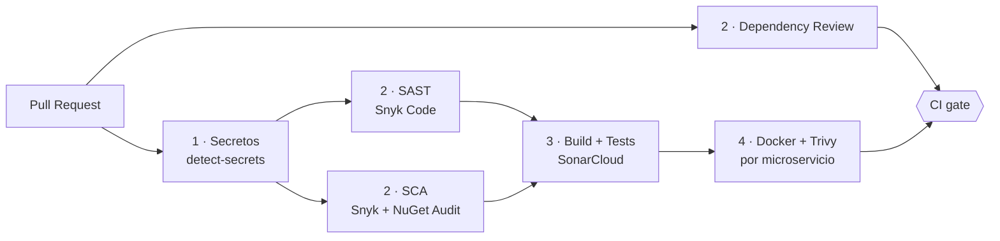

# CryoLogistics 21

Sistema de monitoreo de cadena de frío de grado industrial para el transporte de **terapias génicas** a **-70°C**. Una desviación térmica de más de **5 minutos** invalida el lote completo. El sistema cumple estrictamente con **FDA 21 CFR Part 11** — registros electrónicos auténticos, íntegros y no repudiables.

> Portfolio project — Architecture Kata.

---

## Documentación

| Documento                                                               | Descripción                                                      |
| ----------------------------------------------------------------------- | ---------------------------------------------------------------- |
| [Arquitectura — C4 + Flujo de Datos](docs/architecture/architecture.md) | C4 Nivel 1, C4 Nivel 2, Flujo de telemetría y Firma Electrónica  |
| [Cumplimiento FDA 21 CFR Part 11](docs/compliance/cfr11-mapping.md)     | Audit Trail, Signing Challenge, 4-Eyes Principle                 |
| [Event Store — Schema](docs/schema/event-store.md)                      | DDL PostgreSQL, hash chaining, ejemplos de payload               |
| [ADRs — Índice](docs/adr/README.md)                                     | Todas las decisiones de arquitectura                             |
| [CI / DevSecOps](docs/devsecops/ci-pipeline.md)                         | Pipeline de GitHub Actions, Quality Gates y protección de `main` |

---

## 1. El Desafío

Un laboratorio farmacéutico global requiere monitoreo de grado industrial para el transporte de terapias génicas de alto valor. Una excursión térmica de más de 5 minutos invalida el lote completo, con pérdidas millonarias y riesgo de salud pública. El sistema garantiza trazabilidad completa, firma electrónica con no repudio y detección de excursiones en < 10 segundos.

---

## 2. Requerimientos Funcionales (FR)

| ID   | Nombre                     | Descripción                                                                                                                              |
| ---- | -------------------------- | ---------------------------------------------------------------------------------------------------------------------------------------- |
| FR-1 | Ingesta de Telemetría      | Recepción de datos (Temperatura, GPS, Batería) cada 60 segundos vía gateways IoT.                                                        |
| FR-2 | Motor de Excursiones       | Detección de pérdida de rango térmico y disparo de alertas críticas en **< 10 segundos**.                                                |
| FR-3 | Audit Trail Inmutable      | Registro automático de cada evento (dato de sensor o acción de usuario) **sin posibilidad de borrado físico**.                           |
| FR-4 | Firma Electrónica (CFR 11) | Proceso de liberación de lote que requiere **re-autenticación obligatoria** del usuario de QA (Signing Challenge).                       |
| FR-5 | Sincronización Offline     | Capacidad de reconstruir la línea del tiempo cuando los sensores recuperan conexión (**Backfilling**), respetando el timestamp original. |
| FR-6 | Cálculo de MKT             | Cálculo asíncrono de la **Temperatura Cinética Media** para evaluar la degradación real del producto.                                    |

### Fórmula del MKT

$$T_K = \frac{\Delta H / R}{-\ln\left(\frac{e^{-\Delta H/RT_1} + e^{-\Delta H/RT_2} + \cdots + e^{-\Delta H/RT_n}}{n}\right)}$$

Donde `ΔH` es la energía de activación del producto y `R` es la constante de los gases ideales.

---

## 3. Requerimientos No Funcionales (NFR)

| ID    | Categoría           | Descripción                                                                                                                                 |
| ----- | ------------------- | ------------------------------------------------------------------------------------------------------------------------------------------- |
| NFR-1 | Integridad (ALCOA+) | Cada registro del Audit Trail debe incluir un **hash SHA-256** encadenado al registro anterior para detectar manipulación directa en la DB. |
| NFR-2 | Disponibilidad      | Diseño de alta disponibilidad **99.9%**. La pérdida de telemetría es una falla de cumplimiento crítica.                                     |
| NFR-3 | Latencia            | El dashboard de monitoreo debe reflejar el estado actual en **< 200ms** desde la ingesta del dato.                                          |
| NFR-4 | Seguridad           | Implementación de **RBAC** estricto y gestión de llaves criptográficas mediante un Vault/KMS (Zero-Trust).                                  |
| NFR-5 | Escalabilidad       | Arquitectura capaz de soportar hasta **100,000 sensores** concurrentes sin degradar las alertas de excursión.                               |

### Restricciones (Constraints)

- ❌ **Sin DELETE físico:** La base de datos no debe permitir borrado de registros. Toda eliminación es lógica y auditada.
- 🕐 **UTC obligatorio:** Todos los componentes deben estar sincronizados via **NTP**. El timestamp siempre se almacena en UTC.
- 🔒 **Principio de Cuatro Ojos:** El usuario que crea un envío **no puede** ser quien lo libere (Maker-Checker).

---

> **Cumplimiento FDA 21 CFR Part 11:** ver [docs/compliance/cfr11-mapping.md](docs/compliance/cfr11-mapping.md)

---

## 4. Estrategia de Arquitectura

### Patrones de Diseño

| Patrón                         | Rol en el sistema                                                                                                                             |
| ------------------------------ | --------------------------------------------------------------------------------------------------------------------------------------------- |
| **Event Sourcing**             | La "Verdad Absoluta". El estado se reconstruye a partir de una cadena de eventos inmutables. Cumple nativamente con el Audit Trail de la FDA. |
| **CQRS**                       | Separación total entre la lógica de escritura (comandos) y de lectura (consultas), cada una con su propia base de datos optimizada.           |
| **Proyecciones (Read Models)** | Un proceso asíncrono transforma los eventos en "instantáneas" del estado actual para consultas rápidas.                                       |
| **Optimistic Concurrency**     | Control de versiones por agregado para manejar actualizaciones concurrentes sin locks a nivel de DB.                                          |

### Stack Tecnológico

| Capa                            | Tecnología                                 | ADR    | Justificación                                                                                                             |
| ------------------------------- | ------------------------------------------ | ------ | ------------------------------------------------------------------------------------------------------------------------- |
| **Runtime**                     | .NET 10 / C#                               | —      | LTS, Clean Architecture, handlers manuales sin librería de mediación.                                                     |
| **Write Store (Event Store)**   | PostgreSQL                                 | ADR-01 | Garantía ACID, implementación propia (sin Marten/EventStoreDB), inmutabilidad nativa.                                     |
| **Read Store (Proyecciones)**   | Redis                                      | —      | Latencia ultrabaja (< 1ms). `HSET` para estado actual, `ZADD` para historial por ventana.                                 |
| **Mensajería / Bus de Eventos** | Apache Kafka                               | ADR-02 | Replay nativo por offset (Backfilling FR-5), retención configurable, soporta 100k sensores (NFR-5).                       |
| **Push al Frontend**            | SSE — Server-Sent Events                   | ADR-03 | Canal unidireccional, suficiente para telemetría push. No requiere bidireccionalidad. Cumple NFR-3 (<200ms).              |
| **Identidad y Autenticación**   | Keycloak                                   | ADR-04 | Self-hosted, Docker-native, OAuth2/OIDC/SAML, sin dependencia de nube, sin costo.                                         |
| **Observabilidad**              | OpenTelemetry + Aspire Dashboard (dev)     | ADR-05 | OTel desacopla instrumentación del backend. Aspire Dashboard: zero-config, OTLP nativo, correlación trazas/logs/métricas. |
| **CI / DevSecOps**              | GitHub Actions + SonarCloud + Snyk + Trivy | ADR-11 | Status checks públicos en cada PR; análisis de calidad y seguridad automatizado. Solo CI, sin CD (evita costos cloud).    |

---

> **Flujo de Datos completo:** ver [docs/architecture/architecture.md#flujo-de-datos](docs/architecture/architecture.md#flujo-de-datos)

---

> **Event Store schema (PostgreSQL DDL):** ver [docs/schema/event-store.md](docs/schema/event-store.md)  
> **ADRs completos:** ver [docs/adr/README.md](docs/adr/README.md)

---

## 5. Pipeline de CI / DevSecOps

Cada cambio entra a `main` mediante Pull Request y debe pasar el check **`CI gate`**, que agrega las etapas del pipeline de GitHub Actions. Los workflows son reutilizables y viven en [`reusable-workflows`](https://github.com/mewfeuille115/reusable-workflows).

**Quality Gates de SonarCloud** (sobre código nuevo):

| Métrica                | Umbral |
| ---------------------- | ------ |
| Cobertura              | > 80 % |
| Security Rating        | A      |
| Reliability Rating     | A      |
| Maintainability Rating | A      |
| Líneas duplicadas      | < 3 %  |

> Detalle completo (etapas, secrets, cómo añadir un microservicio): [docs/devsecops/ci-pipeline.md](docs/devsecops/ci-pipeline.md)

---

## 6. Referencias y Normativas

| Documento                                                                                                                     | Descripción                                                         |
| ----------------------------------------------------------------------------------------------------------------------------- | ------------------------------------------------------------------- |
| [FDA 21 CFR Part 11](https://www.ecfr.gov/current/title-21/chapter-I/subchapter-A/part-11)                                    | Norma base para registros electrónicos y firmas electrónicas.       |
| [ALCOA+ Principles](https://www.ispe.org/)                                                                                    | Marco de integridad de datos farmacéuticos.                         |
| [GDP Guidelines — EU Commission 2013/C 343/01](https://eur-lex.europa.eu/legal-content/EN/TXT/?uri=oj:JOC_2013_343_R_0001_01) | Buenas prácticas de distribución de medicamentos (versión vigente). |
| [NOM-059-SSA1-2015](https://dof.gob.mx/nota_detalle.php?codigo=5424575&fecha=05/02/2016)                                      | Norma mexicana para fabricación y distribución de fármacos.         |
| [Mean Kinetic Temperature (ICH)](https://www.ich.org/)                                                                        | Estándar para el cálculo del MKT en estudios de estabilidad.        |

---

> **Diagramas C4:** ver [Arquitectura — C4 Nivel 1 y Nivel 2](docs/architecture/architecture.md)
