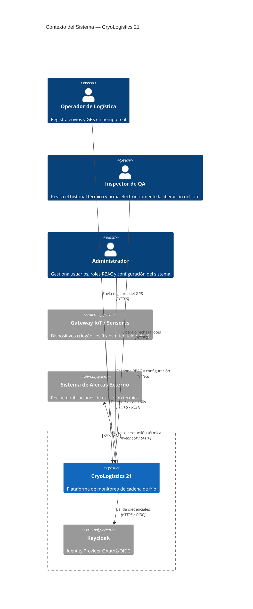
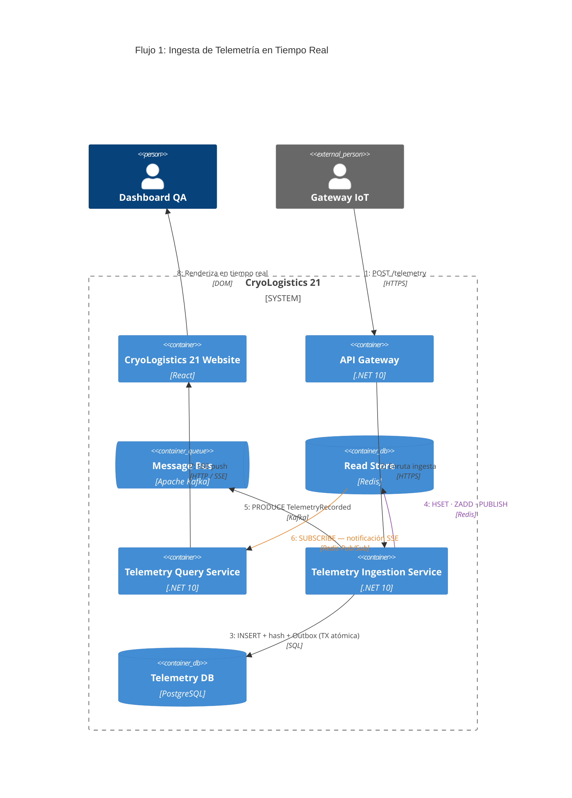
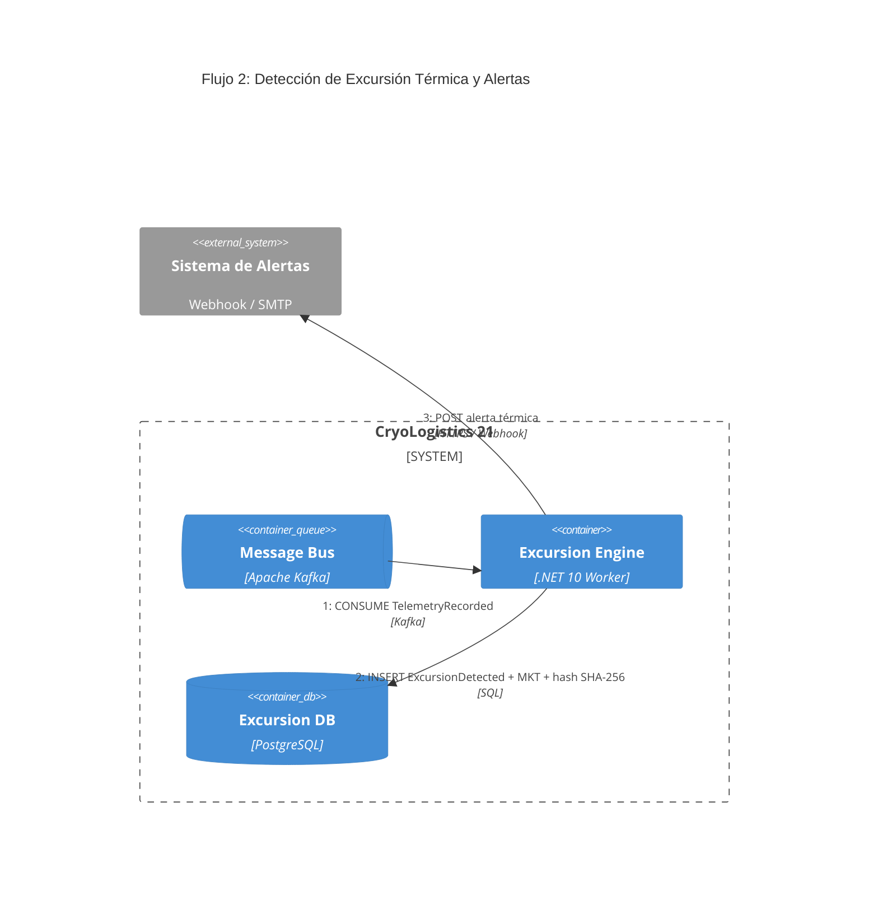
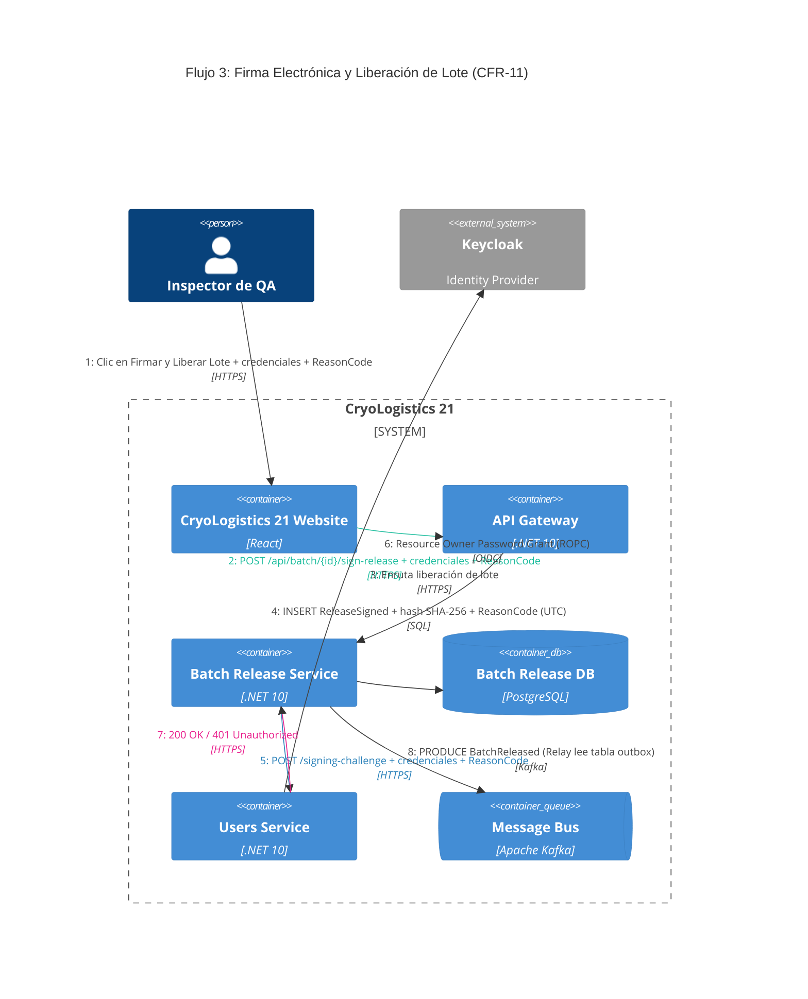
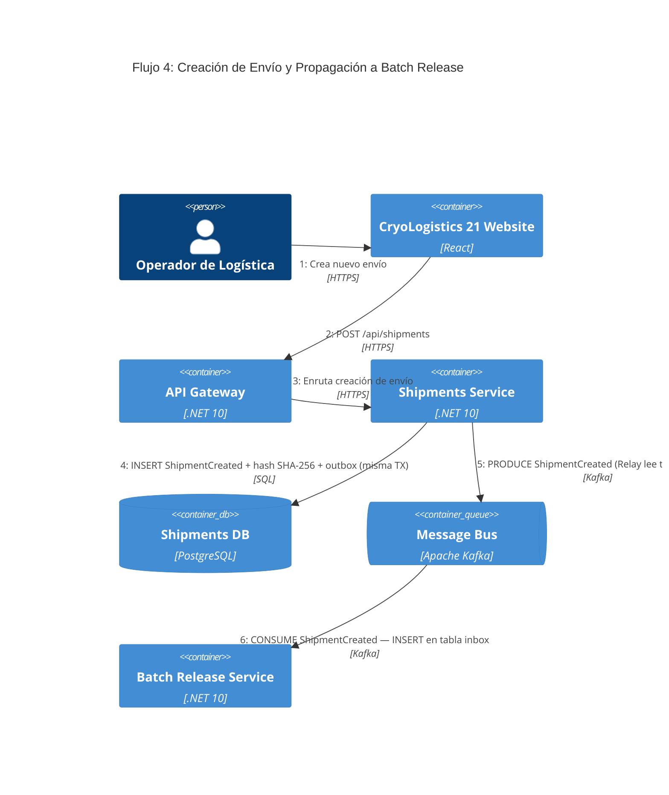

# Arquitectura de Software — CryoLogistics 21

> [← README](../../README.md) | [ADRs](../adr/README.md)

---

## C4 Nivel 1: Contexto del Sistema

| Elemento               | Tipo            | Responsabilidad                                                                                      |
| ---------------------- | --------------- | ---------------------------------------------------------------------------------------------------- |
| Operador de Logística  | Usuario interno | Registra envíos, monitorea temperatura y GPS en tiempo real                                          |
| Inspector de QA        | Usuario interno | Revisa historial térmico, ejecuta firma electrónica (Signing Challenge)                              |
| Administrador          | Usuario interno | Gestiona RBAC, usuarios y configuración del sistema                                                  |
| Gateway IoT / Sensores | Sistema externo | Transmite telemetría criogénica cada 60s. Soporta backfill al recuperar conectividad                 |
| Keycloak               | Sistema externo | Identity Provider OAuth2/OIDC. Valida re-autenticación obligatoria para liberación de lotes (CFR 11) |
| Sistema de Alertas     | Sistema externo | Receptor pasivo de notificaciones de excursión térmica via Webhook/SMTP                              |

---

## C4 Nivel 2: Contenedores

**Arquitectura de microservicios:** Cada bounded context es un servicio desplegable de forma independiente con su propio Event Store (PostgreSQL). No hay llamadas HTTP directas entre servicios — la comunicación asíncrona ocurre exclusivamente a través de Kafka usando el patrón Outbox/Inbox (ADR-10).

**Proyección distribuida:** No existe un Projector central. Cada servicio es responsable de construir y mantener su propio read model en Redis a partir de sus eventos de dominio. El `Telemetry Ingestion Service` proyecta el estado actual en Redis (HSET + ZADD + PUBLISH); el `Telemetry Query Service` lo consume via Pub/Sub y expone el endpoint SSE e historial.

**Excursion Engine como worker dedicado:** Se mantiene como contenedor independiente por su NFR crítico (detección < 10s — FR-2). Consume eventos de integración `TelemetryRecorded` desde Kafka y escala de forma independiente al resto de servicios.

Ver decisiones formales en [ADRs](../adr/README.md).

```mermaid
C4Container
    title Contenedores — CryoLogistics 21

    Person(user, "Inspector QA / Operador", "")
    Person_Ext(iot, "Gateway IoT", "")
    System_Ext(keycloak, "Keycloak", "Identity Provider OAuth2/OIDC")
    System_Ext(alerting, "Sistema de Alertas", "Webhook / SMTP")

    System_Boundary(cryo, "CryoLogistics 21") {
        Container(website, "CryoLogistics 21 Website", "React", "Dashboard de monitoreo en tiempo real. Gestión de envíos. Firma electrónica de lotes")
        Container(gateway, "API Gateway", ".NET 10", "Punto de entrada único. Enruta peticiones y valida JWT")
        Container(users_svc, "Users Service", ".NET 10", "Gestión de usuarios y asignación de roles RBAC via Keycloak")

        Container(excursion_engine, "Excursion Engine", ".NET 10 Worker", "Detecta excursiones térmicas en menos de 10s. Calcula MKT. Dispara alertas")
        Container(shipments_svc, "Shipments Service", ".NET 10", "Ciclo de vida del envío: crear, asignar sensores, cerrar")
        Container(release_svc, "Batch Release Service", ".NET 10", "Signing Challenge CFR-11. Principio de Cuatro Ojos. Libera o rechaza lotes")
        
        ContainerDb(excursion_db, "Excursion DB", "PostgreSQL", "Event Store del Excursion Engine. Registro de excursiones y cálculo MKT")
        ContainerDb(shipments_db, "Shipments DB", "PostgreSQL", "Event Store del Shipments Service. Hash SHA-256 encadenado")
        ContainerDb(release_db, "Batch Release DB", "PostgreSQL", "Event Store del Batch Release Service. Hash SHA-256 encadenado")
        
        Container(telemetry_ingest, "Telemetry Ingestion Service", ".NET 10", "Recibe telemetría IoT y backfill. Persiste en Event Store + Outbox. Proyecta estado en Redis")
        Container(telemetry_query, "Telemetry Query Service", ".NET 10", "Historial térmico. Estado actual. Endpoint SSE via Redis Pub/Sub")

        ContainerDb(redis, "Read Store", "Redis", "Ingestion escribe (HSET+ZADD+PUBLISH). Query lee y expone SSE (SUBSCRIBE)")
        ContainerQueue(kafka, "Message Bus", "Apache Kafka", "Bus de integración asíncrona. Outbox/Inbox pattern")
        ContainerDb(telemetry_db, "Telemetry DB", "PostgreSQL", "Event Store del Telemetry Service. Hash SHA-256 encadenado")
    }

    Rel(iot, gateway, "POST /telemetry", "HTTPS")
    Rel(user, website, "", "")
    Rel(website, gateway, "REST / SSE", "HTTPS")

    Rel(gateway, telemetry_ingest, "", "")
    Rel(gateway, telemetry_query, "", "")
    Rel(gateway, shipments_svc, "", "")
    Rel(gateway, release_svc, "", "")
    Rel(gateway, users_svc, "", "")

    Rel(telemetry_ingest, telemetry_db, "Event Store + Outbox", "SQL")
    Rel(telemetry_ingest, redis, "Proyección de estado", "Redis")
    Rel(telemetry_ingest, kafka, "Eventos de dominio", "Kafka")

    Rel(telemetry_query, telemetry_db, "Historial paginado", "SQL")
    Rel(telemetry_query, redis, "Estado actual + SSE", "Redis")
    Rel(kafka, telemetry_query, "Eventos de integración", "Kafka")

    Rel(shipments_svc, shipments_db, "Event Store + Outbox", "SQL")
    Rel(shipments_svc, kafka, "Eventos de dominio", "Kafka")

    Rel(release_svc, release_db, "Event Store", "SQL")
    BiRel(release_svc, kafka, "Eventos de integración", "Kafka")

    Rel(users_svc, keycloak, "RBAC + Autenticación", "OIDC")

    Rel(kafka, excursion_engine, "Eventos de integración", "Kafka")
    Rel(excursion_engine, excursion_db, "Event Store", "SQL")
    Rel(excursion_engine, alerting, "Alertas térmicas", "HTTPS")

    UpdateRelStyle(telemetry_query, redis, $textColor="red", $lineColor="red")
    UpdateRelStyle(telemetry_ingest, telemetry_db, $textColor="blue", $lineColor="blue")
```

| Contenedor                      | Tecnología               | Responsabilidad principal                                                                                                               |
| ------------------------------- | ------------------------ | --------------------------------------------------------------------------------------------------------------------------------------- |
| **Website**                     | React                    | Dashboard de monitoreo en tiempo real. Gestión de envíos. Firma electrónica de lotes. Consume SSE del API Gateway                       |
| **API Gateway**                 | .NET 10 — Web API        | Punto de entrada único. Enruta al microservicio correspondiente. Valida JWT                                                             |
| **Telemetry Ingestion Service** | .NET 10 — Web API        | Recibe telemetría IoT y backfill. Persiste en Event Store + Outbox. Proyecta en Redis. Publica `TelemetryRecorded` a Kafka (FR-1, FR-5) |
| **Telemetry Query Service**     | .NET 10 — Web API        | Historial térmico paginado, estado actual, endpoint SSE via Redis Pub/Sub. Consume `BatchReleased` para mantener read model actualizado |
| **Shipments Service**           | .NET 10 — Web API        | Ciclo de vida del envío: creación, asignación de sensores, cierre                                                                       |
| **Batch Release Service**       | .NET 10 — Web API        | Signing Challenge (CFR-11), 4-Eyes Principle, liberación/rechazo de lotes                                                               |
| **Users Service**               | .NET 10 — Web API        | Gestión de usuarios y roles RBAC. Único punto de acceso a Keycloak (RBAC + Signing Challenge ROPC)                                      |
| **Excursion Engine**            | .NET 10 — Worker Service | Detecta excursiones < 10s, calcula MKT, dispara alertas externas (FR-2, FR-6)                                                           |
| **Telemetry DB**                | PostgreSQL               | Event Store compartido — Ingestion escribe, Query lee historial paginado. SHA-256 encadenado y tabla outbox                             |
| **Shipments DB**                | PostgreSQL               | Event Store del Shipments Service con SHA-256 encadenado y tabla outbox                                                                 |
| **Batch Release DB**            | PostgreSQL               | Event Store del Batch Release Service con SHA-256 encadenado                                                                            |
| **Excursion DB**                | PostgreSQL               | Event Store del Excursion Engine — excursiones y MKT                                                                                    |
| **Message Bus**                 | Apache Kafka             | Integración asíncrona entre servicios vía eventos de integración (ADR-10)                                                               |
| **Read Store**                  | Redis                    | Ingestion Service escribe (HSET + ZADD + PUBLISH). Query Service lee estado actual y expone SSE (SUBSCRIBE)                             |

---

## Flujo de Datos

Los siguientes diagramas de proceso (C4 Dinámico) detallan la secuencia de comunicación entre contenedores para cada escenario clave. El [diagrama de contenedores](#c4-nivel-2-contenedores) muestra la estructura estática; estos diagramas muestran el orden de los pasos en cada flujo.

---

### Flujo 1 — Ingesta de Telemetría en Tiempo Real

> **Backfilling (FR-5):** Cuando un sensor recupera conectividad, envía los datos acumulados con el **timestamp original del sensor**, no la hora de recepción. El campo `source` distingue los modos:
>
> | `source` | Significado |
> | --- | --- |
> | `"live"` | Dato en tiempo real, recibido dentro de la ventana normal |
> | `"backfilled"` | Dato histórico enviado al recuperar conectividad |
>
> El consumer del Telemetry Service puede hacer `seek` al offset correspondiente al inicio del gap para reprocessar únicamente el rango afectado.

---

### Flujo 2 — Detección de Excursión Térmica y Alertas

> **NFR crítico:** La detección debe completarse en < 10s desde la recepción del evento `TelemetryRecorded` (FR-2). El Excursion Engine escala de forma independiente al resto de servicios para cumplir este requisito.

---

### Flujo 3 — Firma Electrónica y Liberación de Lote (CFR-11 — FR-4)

> Si las credenciales son inválidas (paso 7 retorna 401), **no se inserta ningún evento** y el intento fallido se registra en los logs de auditoría del API.

> Si otro inspector firmó el mismo lote mientras el modal estaba abierto, el paso 4 detecta el `SequenceNumber` desactualizado y retorna `409 Conflict` antes de llegar al Signing Challenge.

---

### Flujo 4 — Creación de Envío y Propagación a Batch Release

