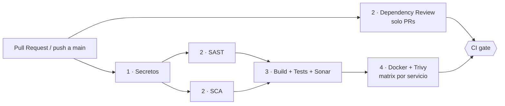

# CI / DevSecOps Pipeline

Pipeline de Integración Continua de CryoLogistics 21 en **GitHub Actions**. Cada Pull Request hacia `main` ejecuta controles de secretos, seguridad, calidad y contenedores antes de poder integrarse.

> **Alcance:** solo CI. No hay Despliegue Continuo (CD) para evitar costos de infraestructura cloud en un proyecto de portafolio.

## Decisiones

| Decisión | Alternativa descartada | Motivo |
| --- | --- | --- |
| GitHub Actions | Jenkins autoalojado | Status checks y ejecuciones visibles públicamente en el repositorio |
| SonarCloud | SonarQube Community local | PR decoration, análisis de ramas/PRs y taint analysis gratuitos en repos públicos |
| Reusable workflows en un repo aparte | Workflows copiados en este repo | Reutilización entre proyectos y versionado (`@v1`) |

## Arquitectura

`.github/workflows/ci.yml` es el *caller*: orquesta las etapas invocando workflows reutilizables (`workflow_call`) del repositorio [`reusable-workflows`](https://github.com/mewfeuille115/reusable-workflows), referenciados por tag.



| Etapa | Herramienta | Workflow reutilizable | Falla si… |
| --- | --- | --- | --- |
| 1. Secretos | Yelp `detect-secrets` | `secret-scan-yelp.yml` | Hay un posible secreto no auditado en `.secrets.baseline` |
| 2. SAST | Snyk Code | `sast-scan-synk.yml` | Hallazgos de severidad ≥ High |
| 2. SCA | Snyk + `dotnet list package --vulnerable` | `sca-scan-synk.yml` | Dependencias vulnerables ≥ High |
| 2. Dependency review | `dependency-review-action` | `dependency-review.yml` | El PR añade dependencias vulnerables |
| 3. Build y calidad | .NET + dotnet-coverage + SonarCloud | `dotnet-build-sonar.yml` | Falla compilación, tests o el Quality Gate |
| 4. Contenedores | Docker + Trivy | `container-scan-trivy.yml` | CVE High/Critical con parche disponible |

Los resultados de seguridad se publican como SARIF en **Security → Code scanning**. El job `CI gate` agrega todo y es el único check requerido.

## Quality Gates (SonarCloud)

Evaluados sobre **código nuevo**. El pipeline espera el resultado del gate (`sonar.qualitygate.wait=true`).

| Métrica | Umbral |
| --- | --- |
| Cobertura | > 80 % |
| Security Rating | A |
| Reliability Rating | A |
| Maintainability Rating | A |
| Líneas duplicadas | < 3 % |

Los umbrales se configuran en SonarCloud (gate "Sonar way"), no en el YAML. La cobertura excluye AppHost, ServiceDefaults, migraciones y `Program.cs`.

## Protección de `main`

Ruleset activo sobre `main`:

- Pull Request obligatorio (0 aprobaciones, desarrollo individual).
- Check requerido: **`CI gate`**.
- Force-push y borrado de la rama bloqueados.
- Reglas aplicadas también a administradores.

## Secrets

| Secret | Uso |
| --- | --- |
| `SNYK_TOKEN` | SAST y SCA |
| `SONAR_TOKEN` | Análisis en SonarCloud |

## Añadir un microservicio

1. Crear su `Dockerfile` junto al proyecto API (contexto de build: raíz del repo).
2. Añadir un bloque a la `matrix` del job `container` en `ci.yml`:

```yaml
- service: <nombre>-api
  dockerfile: src/Services/<Servicio>/Cryologistics21.Services.<Servicio>.Api/Dockerfile
```

## Notas técnicas

- **Proyecto de frontend (`.esproj`):** `dotnet restore` no lo soporta, así que el CI crea una copia temporal de la solución sin él.
- **Tests:** xunit.v3 sobre Microsoft Testing Platform. `global.json` activa el modo MTP de `dotnet test` (.NET 10) y la cobertura se recoge con `dotnet-coverage` en formato XML.
- **Falsos positivos de secretos:** se registran en `.secrets.baseline` (auditados, rutas con `/`).
- **Trivy:** usa `ignore-unfixed`; solo bloquean los CVE con parche disponible.

## Limitaciones conocidas

- Los PRs desde forks no tienen acceso a secrets: el análisis de Sonar se omite y SAST/SCA fallan.
- El frontend (`UI/`) aún no tiene un job de build/lint/test propio.
- Sin CD: no se publican imágenes a ningún registro.